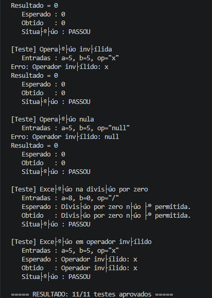
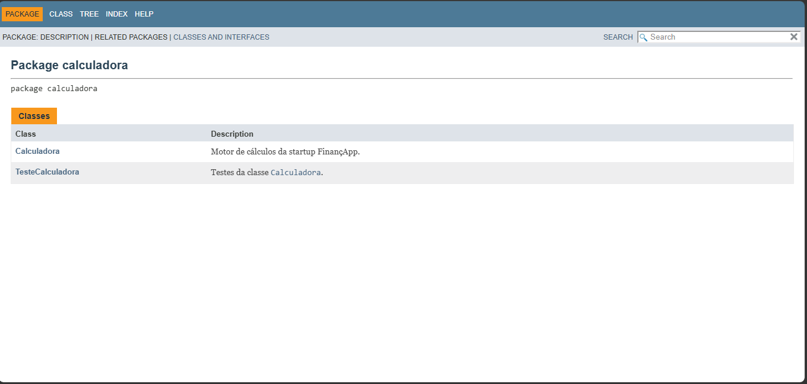
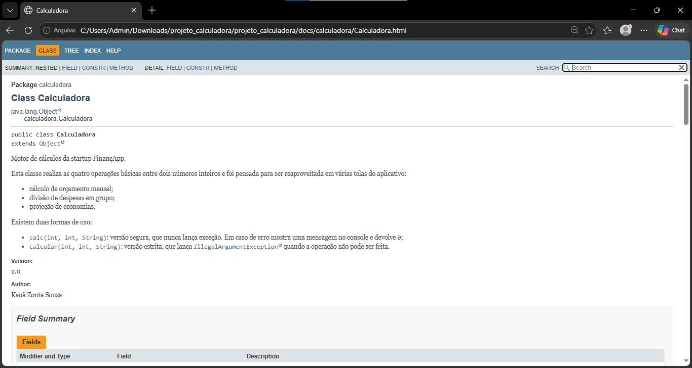

# 🧮 Calculadora FinançApp

> Módulo de cálculo em Java, construído e depois melhorado passo a passo: primeiro fazer funcionar, depois provar que funciona (testes), depois deixar o código limpo (refatoração) e, por fim, explicá-lo (JavaDoc).

---

## 1. Dados do trabalho

| Campo | Informação |
|---|---|
| Aluno | **Kauã Zonta Souza** |
| RA | **251350** |
| Curso | **Análise de Desenvolvimento de Sistemas** |
| Disciplina | **UX/UI e Testes de Software** |
| Professor | **DANIEL DOMINGOS AKIRA DE SA PIMENTEL OHATA** |
| Atividade | Testes Funcionais, Refatoração e Documentação de Software |
| Repositório | https://github.com/KauaZNT/projeto_calculadora |

---

## 2. Sobre o projeto

A **FinançApp** é uma startup fictícia que está criando um aplicativo de finanças pessoais. Várias telas do app precisam fazer contas simples (dividir uma despesa entre amigos, somar gastos do mês, projetar quanto sobra no fim do mês). Em vez de repetir essas contas em cada tela, este projeto entrega **uma única classe, `Calculadora`**, que qualquer parte do app pode chamar:

```java
Calculadora calc = new Calculadora();
int resultado = calc.calc(10, 4, "-");   // 6
```

O método `calc` **sempre devolve um `int`** e guarda esse valor no atributo `r`. Quando algo dá errado (divisão por zero, operador desconhecido), ele mostra uma mensagem no console e devolve `0`, sem derrubar o programa.

---

## 3. O que cada operação faz

| Operador | Operação | Chamada | Retorno | Console |
|:---:|---|---|:---:|---|
| `+` | Soma | `calc(2, 3, "+")` | `5` | `Resultado = 5` |
| `-` | Subtração | `calc(10, 4, "-")` | `6` | `Resultado = 6` |
| `*` | Multiplicação | `calc(3, 5, "*")` | `15` | `Resultado = 15` |
| `/` | Divisão (inteira) | `calc(8, 2, "/")` | `4` | `Resultado = 4` |
| `/` | Divisão por zero | `calc(8, 0, "/")` | `0` | `Erro: Divisão por zero não é permitida.` |
| outro | Operador inválido | `calc(5, 5, "x")` | `0` | `Erro: Operador inválido: x` |

Detalhes de comportamento:
- A divisão é **inteira**: `7 / 2` resulta em `3`, porque o retorno é sempre `int`.
- Operador `null` também é tratado como inválido, então o programa não quebra.
- A versão estrita `calcular(...)` faz as mesmas contas, mas lança `IllegalArgumentException` em vez de devolver `0`.

---

## 4. Requisitos atendidos

**Funcionais**

| ID | Requisito | Situação |
|---|---|:---:|
| RF01 | Somar dois inteiros | ✅ |
| RF02 | Subtrair dois inteiros | ✅ |
| RF03 | Multiplicar dois inteiros | ✅ |
| RF04 | Dividir dois inteiros | ✅ |
| RF05 | Bloquear divisão por zero com mensagem | ✅ |
| RF06 | Avisar quando o operador não é suportado | ✅ |

**Qualidade**

| ID | Requisito | Como foi atendido |
|---|---|---|
| RNF01 | Código legível | Métodos pequenos, nomes claros, indentação padronizada |
| RNF02 | Testável | 11 casos de teste com entrada, esperado e obtido |
| RNF03 | Refatorável sem mudar comportamento | Os 9 testes originais rodaram de novo e continuam passando |
| RNF04 | Documentado | JavaDoc em todas as classes, atributos e métodos |
| RNF05 | Versionado | Git com commits pequenos e duas branches |
| RNF06 | Confiável | Nenhuma entrada inválida interrompe a execução de `calc` |

---

## 5. Ferramentas

| Ferramenta | Versão | Para que foi usada |
|---|---|---|
| Java / JDK | 24 | Escrever e compilar o código |
| Visual Studio Code | — | Editor e terminal |
| Git | — | Controle de versão (branches `main` e `Refatoracao`) |
| GitHub | — | Repositório remoto |
| JavaDoc | JDK 24 | Gerar a documentação HTML |
| Testes | — | Escritos em Java puro na classe `TesteCalculadora` (sem biblioteca externa) |

---

## 6. Organização das pastas

```text
projeto_calculadora/
├── src/
│   └── calculadora/
│       ├── Calculadora.java        ← lógica das operações
│       └── TesteCalculadora.java   ← 11 testes com saída detalhada
├── docs/
│   └── index.html                  ← JavaDoc gerado
├── images/
│   ├── testes/                     ← print da execução dos testes
│   ├── javadoc/                    ← prints da documentação
│   └── refatoracao/                ← print dos testes após a refatoração
├── .gitignore
└── README.md
```

---

## 7. Como rodar

Na raiz do projeto, no terminal do VS Code (PowerShell), um comando por vez:

```powershell
# compilar
javac -encoding UTF-8 -d out src\calculadora\Calculadora.java src\calculadora\TesteCalculadora.java

# executar os testes
java "-Dfile.encoding=UTF-8" "-Dstdout.encoding=UTF-8" -cp out calculadora.TesteCalculadora

# gerar a documentação
javadoc -author -version -encoding UTF-8 -charset UTF-8 -docencoding UTF-8 -d docs -sourcepath src calculadora
```

Para ler a documentação, abra `docs/index.html` no navegador.

---

## 8. Testes

Cada teste imprime as **entradas**, o **resultado esperado**, o **resultado obtido** e a **situação**.

| # | Cenário | Entradas (a, b, op) | Esperado | Resultado |
|:-:|---|---|---|:---:|
| 1 | Soma | 2, 3, `+` | `5` | ✅ |
| 2 | Subtração | 10, 4, `-` | `6` | ✅ |
| 3 | Subtração com resultado negativo | 3, 8, `-` | `-5` | ✅ |
| 4 | Multiplicação | 3, 5, `*` | `15` | ✅ |
| 5 | Divisão exata | 8, 2, `/` | `4` | ✅ |
| 6 | Divisão inteira | 7, 2, `/` | `3` | ✅ |
| 7 | Divisão por zero | 8, 0, `/` | `0` e mensagem de erro | ✅ |
| 8 | Operação inválida | 5, 5, `x` | `0` e mensagem de erro | ✅ |
| 9 | Operação nula | 5, 5, `null` | `0` e mensagem de erro | ✅ |
| 10 | Exceção na divisão por zero | 8, 0, `/` | `IllegalArgumentException` com a mensagem de divisão | ✅ |
| 11 | Exceção em operador inválido | 5, 5, `x` | `IllegalArgumentException` com a mensagem de operador | ✅ |

**Resultado final: 11 de 11 testes aprovados.** Os testes 1 a 9 existem desde a versão original; os 10 e 11 foram acrescentados na refatoração.

### Print da execução dos testes

<!-- Salve o print em images/testes/testes.png -->


---

## 9. Refatoração (branch `Refatoracao`)

A primeira versão funcionava, mas tinha tudo dentro de um único método, com `if / else if` em cadeia, mensagens espalhadas e o atributo `r` aberto para qualquer classe alterar. Na branch `Refatoracao` o resultado visto por quem usa `calc` foi mantido, e a organização mudou:

| Técnica aplicada | Antes | Depois |
|---|---|---|
| Extração de métodos | Contas feitas dentro do `calc` | `somar`, `subtrair`, `multiplicar` e `dividir` |
| Simplificação de condicionais | `if / else if / else` aninhados | `switch` com um `case` por operador, no método `calcular` |
| Tratamento de erro | `println` e `r = 0` dentro de cada ramo | `calcular` lança `IllegalArgumentException`; `calc` captura e mostra a mensagem |
| Eliminar repetição | Textos de erro escritos no meio do código | Constantes `MSG_DIVISAO_POR_ZERO` e `MSG_OPERADOR_INVALIDO` |
| Encapsulamento | `public int r` | `private int r` com o método `getR()` |

Depois da refatoração os 9 testes originais foram executados de novo e **continuaram todos aprovados**, confirmando que os retornos não mudaram.

### Print dos testes após a refatoração

<!-- Salve o print em images/refatoracao/testes-apos-refatoracao.png -->


---

## 10. Documentação (JavaDoc)

Foram documentados classes, constantes, atributo, construtor, métodos, parâmetros (`@param`), retornos (`@return`), exceções (`@throws`), além de `@author` e `@version`. A saída HTML está na pasta `docs/`.

### Prints do JavaDoc

<!-- Salve os prints em images/javadoc/ -->



---

## 11. Histórico do Git

| Branch | Conteúdo |
|---|---|
| `main` | Versão original: `.gitignore`, `Calculadora`, `TesteCalculadora` (9 testes) e README inicial |
| `Refatoracao` | Código refatorado, 11 testes, JavaDoc, pasta `docs/` e README final |

Os commits seguem o padrão `feat:`, `test:`, `refactor:` e `docs:`, um por mudança.

---

## 12. Link do repositório

🔗 https://github.com/KauaZNT/projeto_calculadora
